

  

<h1 align="center">Hush</h1>

A quiet code editor where the code gets the room, and tools come when you call them.

  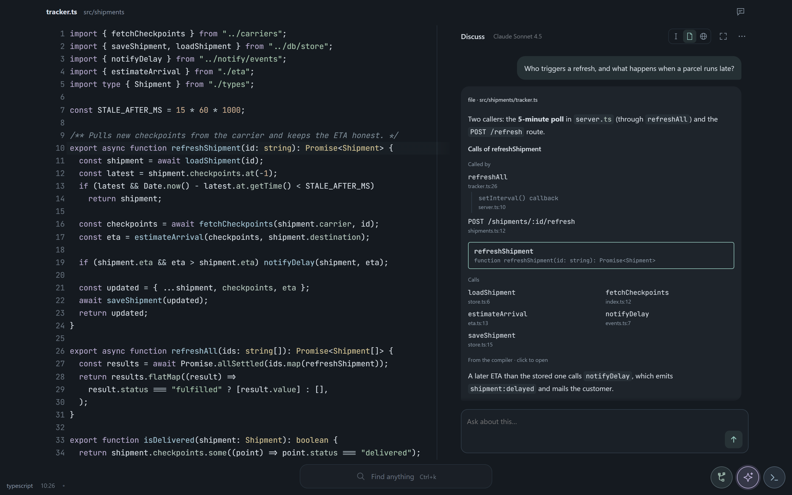

## Why Hush

- **Code is the centrepiece.** No side panels or tab rows, and very little UI text.
  The file fills the window.
- **Tools appear on demand.** Search, Git, the terminal and the AI open over the code
  when you need them. Escape puts them away.
- **Understand the code, not just edit it.** Lenses and the AI explain structure,
  callers and flow right beside the lines they talk about.

Hush is built with Tauri, CodeMirror 6 and a Rust core.

## Download

Get the latest build from the
[releases page](https://github.com/adrianderstroff/hush-ide-releases/releases/latest):

| System                          | File                                                    |
| ------------------------------- | ------------------------------------------------------- |
| Windows 10/11, x64              | `…_x64-setup.exe` (or the `.msi`)                       |
| macOS (Apple silicon and Intel) | `…_universal.dmg`                                       |
| Linux, x64                      | `.AppImage`, `.deb` (Debian, Ubuntu) or `.rpm` (Fedora) |

The builds are not signed yet, so the first start asks once:

- **Windows:** SmartScreen shows "Windows protected your PC". Choose
  **More info › Run anyway**.
- **macOS:** right-click Hush in Applications and choose **Open**. On macOS 15 and
  later, try to open it once, then choose **Open Anyway** in System Settings › Privacy
  & Security. Or run `xattr -dr com.apple.quarantine /Applications/Hush.app` in
  Terminal.
- **Linux:** make the AppImage executable (`chmod +x Hush_*.AppImage`) and start it.

## Find anything

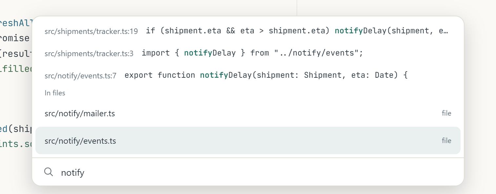

One field for everything: press **Ctrl+K** (**⌘K** on macOS). It finds files, text in
files, actions, settings, lenses and plugins. Start a query with `#` to search text
only. Settings change in the same field: pick a setting, pick a value, press Enter.

## The AI guide

Ask about a selection, the current file or the whole project. The answer sits beside
the code. When it walks you through something, each step is pinned to its lines, and
the editor scrolls to them as you go.

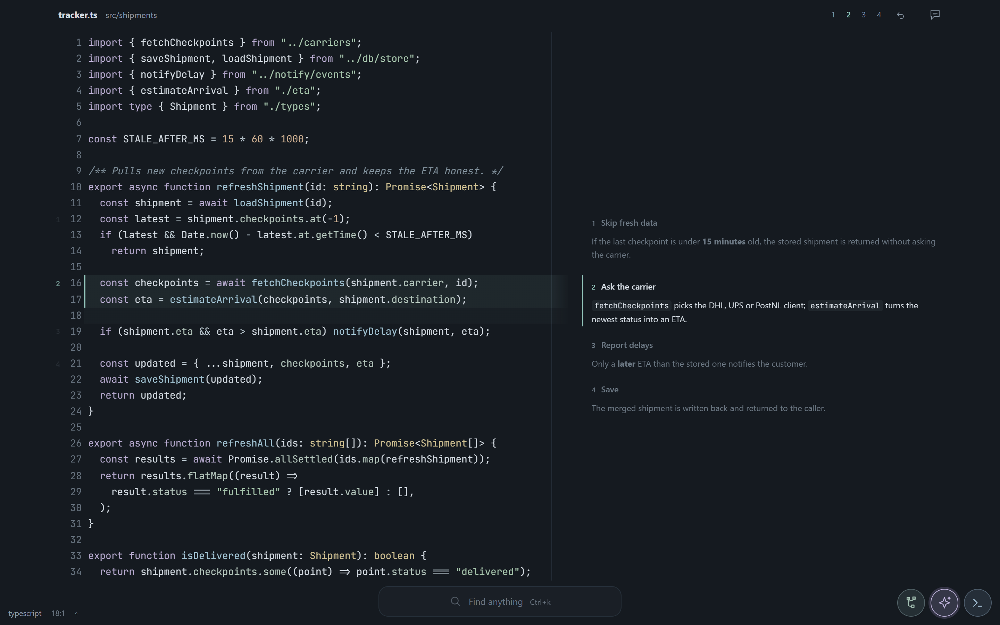

For project questions the model reads the project itself, through tools that respect
your ignore files and keep secrets out. When it suggests a fix, the change shows up in the
editor as a pending edit with its reason. Keep or undo each change in place. Nothing
is written to disk until you keep it, and saving a file with pending changes opens a
merge view.

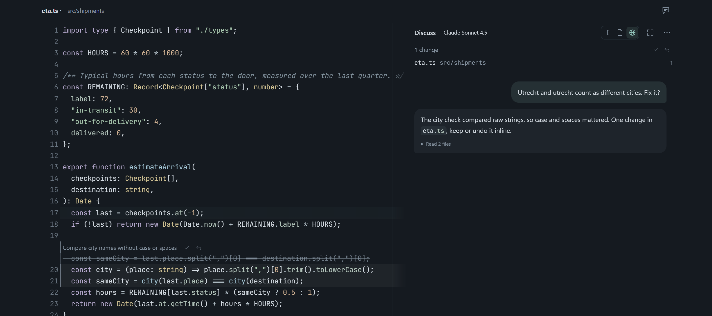

Hush works with Claude, OpenAI, Gemini, Ollama, any OpenAI-compatible server, or your
ChatGPT account through the Codex CLI.

## Lenses

Lenses answer questions you would otherwise work out by reading: who calls this
function, what this type actually contains, what this file imports and who imports
it, which routes, messages and events the project defines, and what your latest edits
affect. There are 11, including call hierarchy, type shape, imports, routes and
events, change impact, and a buffer layout and render pipeline view for WebGPU.

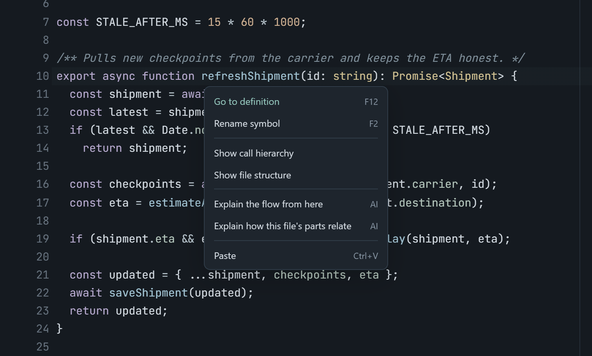

Open them from Find anything, from the right-click menu (which only lists what applies
where you clicked), or from a faint mark in the gutter on the few lines where one is
useful. The AI can also put a lens in its answer. Turn lenses on and off on the
**Lenses** page.

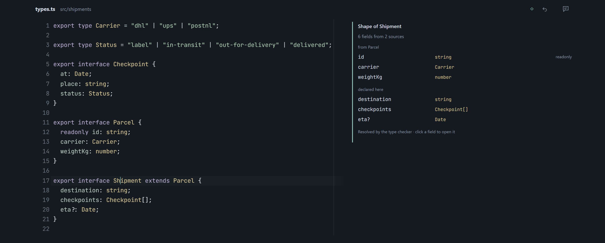

## Plugins

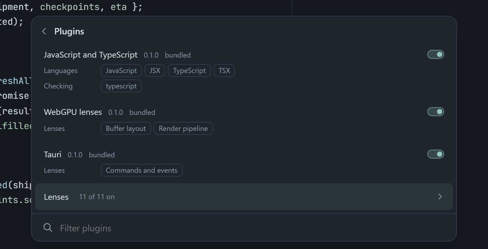

Plugins are plain JSON manifests, so no plugin code runs inside the editor. A manifest
can add languages, a language server for checking, lenses and where they show up,
framework sources for routes and events, and AI providers. The **Plugins** page shows
what each one adds and lets you switch it off.

## Widgets

Git, AI and the terminal are small round pills in the corner. Click one and its card
opens beside it. Drag a pill anywhere and its card opens toward the middle of the
window. You can also add your own pills that run an action, such as Save.

  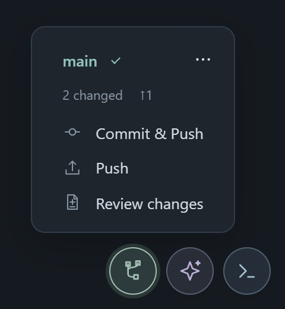
  &nbsp;
  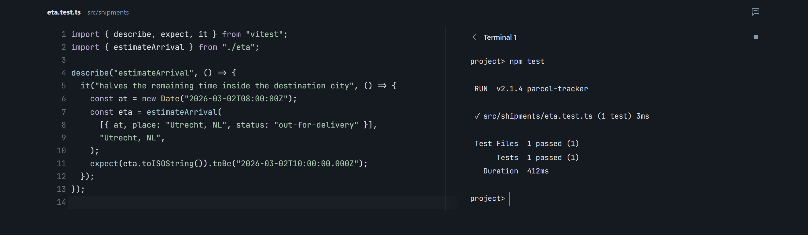

The Git card puts the most likely next step first: commit and push, push, or review.
The terminal is a real shell. It sits next to your code on wide windows and keeps
running while it is hidden.

## Navigation

Moving between files is keyboard-first and uses one chord, **Ctrl+Alt** (**⌘⌥** on
macOS). In the default style, **Next to**, holding the chord shows the neighbouring
files around the current one: the folder to the left and right, the files that use
this one above, and the files it imports below. An arrow key moves you there.

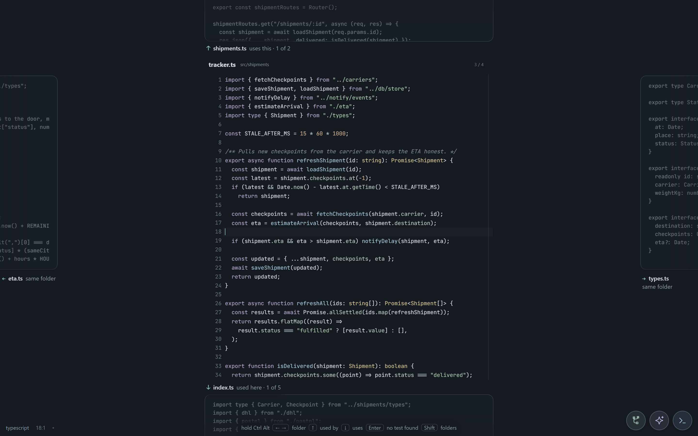

Pick the style that suits you in settings (`Navigation style`):

| Style   | How you use it | What you see                                                                |
| ------- | -------------- | --------------------------------------------------------------------------- |
| Next to | hold Ctrl+Alt  | neighbouring files around the current one                                   |
| Trails  | hold Ctrl+Alt  | a timeline of the places you visited                                        |
| Strip   | hold Ctrl+Alt  | recent files, imports and importers along the edge                          |
| Find    | tap Ctrl+Alt   | Find anything browsing folders, with a preview                              |
| Columns | tap Ctrl+Alt   | the path as columns, like a Finder window                                   |
| Zoom    | tap Ctrl+Alt   | file, folder and project levels; the project as a treemap, spine or circles |

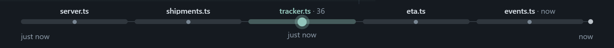

You can set a second style on **Ctrl+Tab**. Back and forward always work with
**Alt+←/→** and the mouse side buttons.

## Status

Hush is early and changing quickly. It is developed and tested on Windows. The macOS
and Linux builds are built and pass a start-up check automatically, but are otherwise
untested so far. No build is signed yet.
